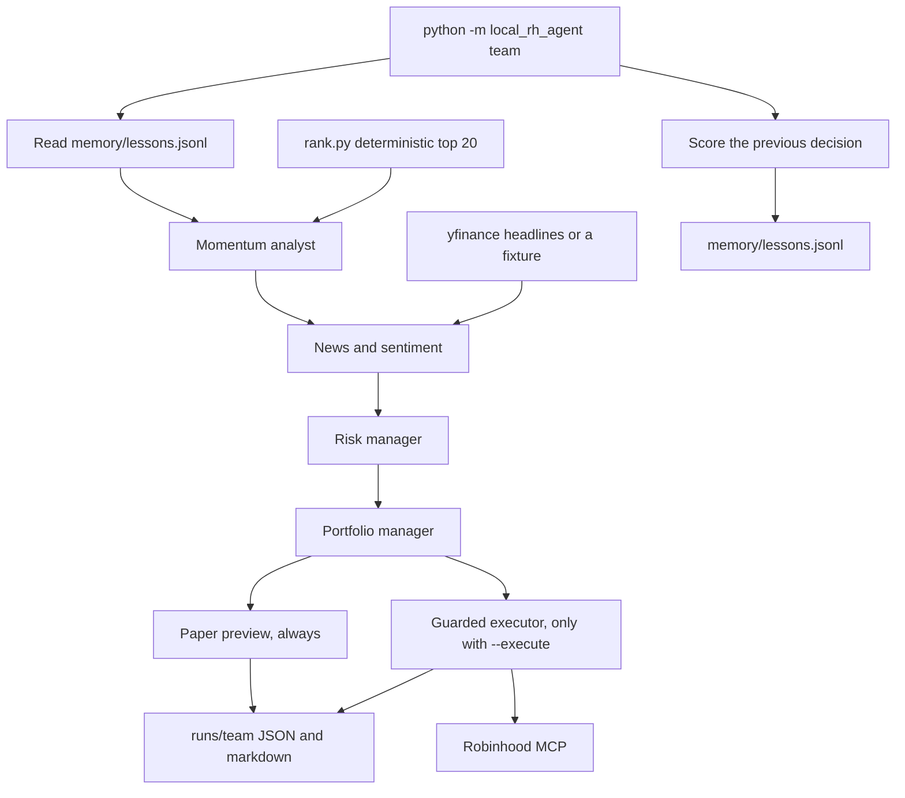

# Local RH Agent

A local momentum book with a small research team in front of one guarded Robinhood executor.

The Monday job is unchanged. On the first open session of the month it ranks the finished prior month, sells the agentic book, and buys the top 20 equal weight, preferring a mapped 2× long single-stock ETF from `vehicles.json`. Ranking is Python. The model does not invent the top 20.

The new path runs beside that job. Four agents write a memo each. Risk can veto or resize. The portfolio manager emits the only order list. The existing executor is still the only code that can call Robinhood order tools, and only if you pass `--execute`. `DRY_RUN=1` is the default. Mutating tools are dropped before a request leaves the machine.

- **LLM:** Ollama by default (`qwen2.5:3b`), or any OpenAI-compatible chat API. Tests and the backtest use a deterministic mock.
- **Broker:** Robinhood Trading MCP at `https://agent.robinhood.com/mcp/trading`
- **Schedule:** macOS launchd, Mondays 9:45am in the Mac's timezone. The job still calls `monthly`.

Orders can only be placed in the Robinhood **Agentic** account (`agentic_allowed: true`). The client refuses order tools for every other account, on top of what Robinhood enforces.

## Architecture



Research agents never import the broker client. The paper preview calls `RobinhoodMcp.call_tool` with `dry_run=True`, which returns before any socket is opened. `--execute` is the only switch that builds a live client, and it still honors `DRY_RUN`.

## How the agents collaborate

Each run writes `runs/team/YYYY-MM-DD/<agent>.json` and a matching markdown file. The JSON is the book. The markdown quotes the model under a line that says commentary cannot change ranks, scores, weights, or orders.

1. **Momentum** copies the ranking. A ticker that appears only in the model's reply is recorded as ignored. Index products such as TQQQ, UPRO, and SOXL are stripped so they cannot stand in for a single-stock vehicle.
2. **Sentiment** asks yfinance for a few headlines per name and scores them with a small word list. An empty feed, or an exception, leaves the score unset. Risk will not veto a name for missing news.
3. **Risk** starts at equal weight, then applies the caps in `.env` (10% per name, 40% per sector, 50% in leveraged ETFs). A score at or below `SENTIMENT_VETO` (default -0.5) drops that name. If the leveraged sleeve is still too big, the weakest vehicles are swapped back to the stock. Buying power under $20 vetoes the book. Names missing from `sectors.json` are sector `Unknown`, and Unknown is capped like any other sector.
4. **Portfolio** copies the rows risk kept. It cannot restore a veto or raise a dollar amount. Dollars are illustrative, from `PAPER_BUYING_POWER` (default $10,000), leaving about $1 of cash. A live executor rescales the same weights to the account.
5. **Executor** is the existing tool loop: `review_equity_order` before `place_equity_order`, agentic account only, stable `ref_id` per symbol, side, and day. The prompt sells the current equity book and then buys only the approved list. If risk vetoed everything, the prompt says not to sell and not to buy. The saved report uses kind `team_execution`, so it does not look like the Monday `monthly_rebalance` and will not block that job.

If the model is down or returns garbage, the memo says the commentary fell back and the Python book is unchanged. Memo calls are one shot and have no tools, so a 3B model is not asked to drive the Robinhood schema during research.

## Safety

- `DRY_RUN` defaults to 1. `place_*`, `cancel_*`, and the other write prefixes are dropped inside `RobinhoodMcp.call_tool` before HTTP. `review_*` is not a write; it still runs when you actually `--execute`.
- There is no CLI flag that turns dry-run off. Live orders require `DRY_RUN=0` in `.env` and `team --execute` without `--dry-run`. If the environment is still dry, the team executor forces the client back to dry-run.
- `order_guard` refuses an order tool until `get_accounts` has produced an `agentic_allowed` account, and it refuses every other account number. The paper preview prints that refusal next to the dry-run block. It uses the fake account id `paper-agentic` and does not contact Robinhood.
- Tests and GitHub Actions use the mock provider. They do not log in and they do not send orders. The workflow sets `DRY_RUN=1` and `MODEL_PROVIDER=mock`.

`runs/` and `memory/` are gitignored. A real `--execute` transcript can contain account numbers.

## Setup

```bash
cd ~/Documents/projects/local-rh-agent
./scripts/setup.sh
source .venv/bin/activate
```

`DRY_RUN=1` is the default. Mutating tools are dropped before the request leaves the machine. `review_*` still runs on an execute.

### Authenticate once

```bash
python -m local_rh_agent auth
```

A browser opens to Robinhood. Approve the Agentic / MCP account. Tokens land in `.tokens/rh_mcp.json` (mode 0600, gitignored). This does not reuse a Cursor plugin session.

### Check

```bash
python -m local_rh_agent status
python -m local_rh_agent tools
python -m local_rh_agent run "List my accounts and say which one is agentic. Do not place orders."
```

### Monday job

The Mac clock should be US Eastern. The job wakes every Monday at 9:45 local time and exits immediately unless that day is the first open session of the month (Monday, or Tuesday when Monday is a holiday).

```bash
./scripts/install_launchd.sh     # enable
./scripts/uninstall_launchd.sh   # disable
```

Log: `runs/launchd.log`. Reports from a real monthly run: `runs/YYYY-MM-DD-entry.md` and `.json`.

Try the monthly path without waiting for the first Monday, still with dry-run:

```bash
python -m local_rh_agent monthly --force
```

When you want that job to send orders, set `DRY_RUN=0` in `.env`. A month that already has a live `monthly_rebalance` report will not trade again.

## Commands

| Command | What it does |
|---|---|
| `python -m local_rh_agent auth` | OAuth login, save tokens |
| `python -m local_rh_agent status` | Ollama, team provider, token, MCP, Monday gate |
| `python -m local_rh_agent tools` | Print MCP tool names |
| `python -m local_rh_agent run "…"` | One agent turn on the broker tool loop |
| `python -m local_rh_agent rank` | Prior-month top 20, no broker |
| `python -m local_rh_agent monthly` | Calendar gate, then rank, then the model trades |
| `python -m local_rh_agent team --dry-run` | Research memos and a paper order list. No broker. |
| `python -m local_rh_agent team --dry-run --execute` | Same book, handed to the guarded executor. `place_*` still blocked while `DRY_RUN=1`. |
| `python -m local_rh_agent backtest --offline` | Replay the synthetic panel. Writes a report and `equity.png`. |
| `python -m local_rh_agent reflect` | Score the previous team decision and append a lesson. No orders. |
| `./scripts/agent_on.sh` / `agent_off.sh` | Enable / disable the Monday job |

## Models

Research memos and the broker tool loop are configured separately. Memos go through `MODEL_PROVIDER`. The tool loop stays on Ollama, because that is the path already checked for tool calls on this machine. Pointing the executor at a hosted model would mean trusting a different model with order tools, and that is not wired up.

### This Mac (8GB)

`qwen2.5:3b` is the default. It answers quickly and emits real tool calls. `qwen3.5:latest` is also pulled here, but a one-line prompt returned no tokens, so the Monday job does not use it. A 3B model will mis-fill tool arguments. Read `runs/*-transcript.json` after a `--force` dry run before you turn `DRY_RUN` off.

```bash
# .env
MODEL_PROVIDER=ollama
OLLAMA_HOST=http://127.0.0.1:11434
OLLAMA_MODEL=qwen2.5:3b
OLLAMA_NUM_CTX=8192
TEAM_NUM_CTX=4096
OLLAMA_TEMPERATURE=0.2
DRY_RUN=1
```

`OLLAMA_NUM_CTX` is the tool loop. 8k fits the short monthly tool list; 16k swaps hard on an 8GB Mac when the tool list is large. `TEAM_NUM_CTX` is only the memo call, which has no tools. To try a larger local model on this machine:

```bash
ollama pull qwen2.5:14b
```

Then set `OLLAMA_MODEL`, or set `MOMENTUM_MODEL` and the other `*_MODEL` names if you want one role on a different tag.

### Hosted, or a bigger computer later

Any server that speaks `POST /chat/completions` works. OpenAI:

```bash
MODEL_PROVIDER=openai
OPENAI_BASE_URL=https://api.openai.com/v1
OPENAI_API_KEY=sk-...
OPENAI_MODEL=gpt-4o-mini
OPENAI_TIMEOUT_S=60
```

A local server on a new machine (LM Studio, llama.cpp, vLLM) is the same switch:

```bash
MODEL_PROVIDER=openai
OPENAI_BASE_URL=http://127.0.0.1:8080/v1
OPENAI_API_KEY=local
OPENAI_MODEL=qwen2.5:32b
```

Mix them. Small local model for the analysts, hosted model for the portfolio writeup:

```bash
MODEL_PROVIDER=ollama
PORTFOLIO_PROVIDER=openai
PORTFOLIO_MODEL=gpt-4o-mini
```

Role names: `MOMENTUM`, `SENTIMENT`, `RISK`, `PORTFOLIO`, `REFLECTION`. `team --provider mock` forces every role for that process. The backtest defaults to mock so it does not call Ollama or the network.

`mock` returns fixed JSON, including a fake ticker `ZZZZ`. The memos record that ticker as ignored. Use it for CI, the backtest, and a demo with the laptop offline.

## Weekly reflection

Memory is `memory/lessons.jsonl`, one JSON object per line, plus `memory/lessons.md` for reading. Nothing is embedded in a vector store. Both files are gitignored.

Each team run starts by scoring the previous decision from that date to today, appends a lesson, then builds today's book with the file in the prompt. The lesson sentence is Python. The model may add a comment; the risk manager does not read that comment as an instruction.

One number changes the next book. If the leveraged sleeve lost more than 8%, the next run caps leveraged ETFs at 25%. The run after that follows the newest lesson, so the tight cap lasts a single decision. If a price is missing, no lesson is written and the next run tries again.

```bash
python -m local_rh_agent reflect
```

That only writes the lesson. It does not propose orders. It uses yfinance for the held symbols and SPY.

## Backtest

```bash
python -m local_rh_agent backtest --offline
```

Writes `runs/backtest/report.json`, `report.md`, and `equity.png`, plus one memo folder per month under `runs/backtest/months/`. The default panel is seeded synthetic prices (18 large-cap names, SPY, and 2× vehicles) so the harness runs in CI with no market data and no API key.

The chart compares three books: the team, plain momentum (equal weight the same names in the underlyings, no leverage and no veto), and SPY buy and hold. Metrics are total return, max drawdown, and Sharpe. Sharpe uses monthly returns, annualized with sqrt(12), and a risk-free rate of 0.

Replay your own month-end closes:

```bash
python -m local_rh_agent backtest --prices prices.csv --top 20
```

Columns: `date,symbol,close,sector,vehicle`. Set `vehicle` on the underlying row to the leveraged ticker. Give that ticker its own rows and leave its sector blank, or it will be ranked as if it were a stock. Include SPY with a blank sector.

On the default tape the harness buys the top 8 of 18 names. Equal weight is 12.5%, which is above the 10% name cap, so the team holds residual cash every month. A live book is the top 20, where equal weight is 5% and that particular cap does not bind by itself. Sector and leverage caps still can.

## Try it

No Ollama, no Robinhood, no network:

```bash
python -m local_rh_agent team --dry-run --provider mock --offline --buying-power 10000
python -m local_rh_agent backtest --offline
pytest
```

The offline team uses the fixture's latest March and plants a harsh headline on that month's winner so you can see a veto in `risk.md`. For the current fixture that date is 2025-03-31. Those headlines are not news.

Live ranking and live headlines, still with no orders:

```bash
python -m local_rh_agent team --dry-run
```

Ollama has to be running unless `--provider` is `mock` or `openai`.

## Limitations

- The default backtest is not a track record. Prices are synthetic, the 2× series compounds twice the underlying's monthly return, and March and September attach fake headlines so the veto path runs. Real single-stock leveraged ETFs reset daily. Volatility decay, costs, slippage, and taxes are not in the numbers. Do not read `equity.png` as evidence of an edge.
- Sentiment is a word list over whatever yfinance returned. It misses sarcasm and it will treat a word like "strong" as positive. When the feed is empty, nothing is vetoed.
- `sectors.json` covers large names, not the whole S&P 500. Extend it when Unknown starts to dominate a book.
- A paper run does not see live positions. It proposes buys and tells the executor to sell the equity book first. It does not diff the account.
- The 3B model writes commentary. If the reply is not JSON, the memo says so. The same model, on `--execute`, can still pass bad tool arguments. The guards catch the account and the dry-run block. They do not catch a wrong symbol that risk already approved.
- Reflection changes the next book in one place only: the leveraged cap after a sleeve loss worse than 8%. Other lessons are context for the writeup.

## Disclaimer

Not investment advice. Leveraged single-stock ETFs reset daily. You are responsible for every order this process places. Fund the Agentic account only with money you can lose to a bad tool call.
